# Performance Investigation of Parallel-Connected Two Overhead Long Transmission Lines

Lab project for **EEE 321L/322 – Power System I Laboratory**, Department of EEE, BRAC University (Summer 2023).

Two scaled overhead-line models were connected in parallel on a three-phase lab bench and loaded in five R‑L steps. I recorded voltages, currents, active and reactive power, and power factor for three configurations. I then used MATLAB to rebuild the equivalent circuit from the measurements and draw the phasor diagrams to scale.

<p align="center">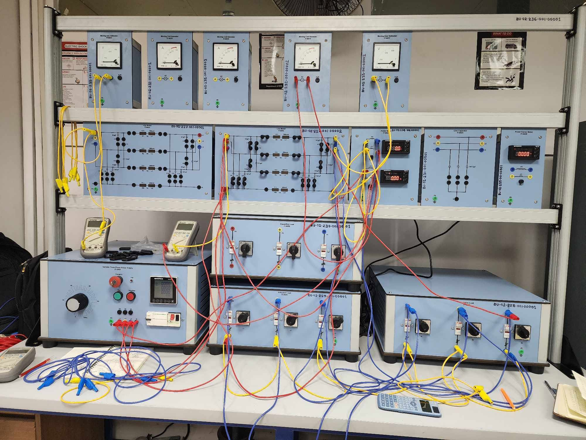</p>

## Objectives

1. Measure how current is distributed between two lines connected in parallel.
2. Investigate how the line operating capacitances affect voltages and currents.

## Notation

| Symbol | Meaning |
|---|---|
| **A**, **E** | Sending end (source) and receiving end (load) |
| V<sub>A</sub>, V<sub>E</sub> (U<sub>E</sub>) | Phase voltage at the sending and receiving ends |
| I<sub>1</sub>, I<sub>2</sub> | Currents in line 1 and line 2 |
| I<sub>A</sub>, I<sub>E</sub> | Total sending-end current and load current |
| I<sub>AE</sub> | Current through the series impedance (I<sub>E</sub> plus the receiving-end charging current) |
| I<sub>A01</sub>, I<sub>A02</sub>, I<sub>E01</sub>, I<sub>E02</sub> | Charging currents of the shunt capacitances at each end of each line |
| Z<sub>1</sub>, Z<sub>2</sub>, Z<sub>tot</sub> = R<sub>tot</sub> + jX<sub>tot</sub> | Series impedances of each line and of both lines in parallel |
| B | Total shunt susceptance at each end (π‑model) |
| P<sub>1</sub>, Q<sub>1</sub> / P<sub>2</sub>, Q<sub>2</sub> | Active and reactive power at the sending end / receiving end |
| η = P<sub>2</sub>/P<sub>1</sub> | Transmission efficiency |

## Equivalent circuits

| Simplified (shunt neglected) | With shunt (capacitive) elements |
|---|---|
| 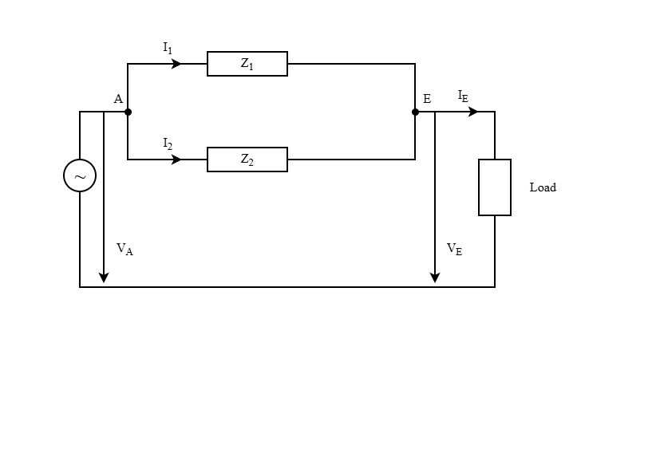 | 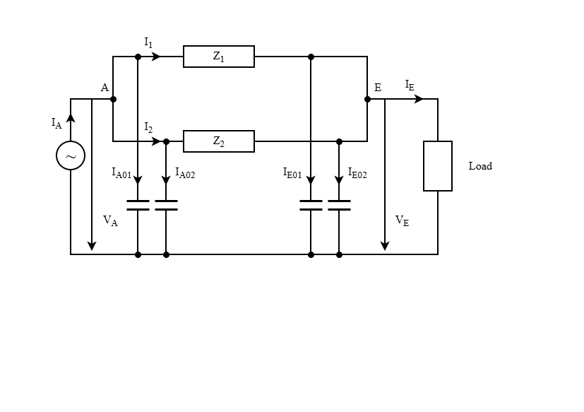 |

Editable source: [`diagrams/Equivalent_Circuits.drawio`](diagrams/Equivalent_Circuits.drawio). Open it in [diagrams.net](https://app.diagrams.net); it has one page per circuit.

### Key equations

```
Z1 = R1 + jωL1        Z2 = R2 + jωL2
1/Z_tot = 1/Z1 + 1/Z2          →  Z_tot = R_tot + jX_tot
I1 = (Z_tot / Z1) · IE         I2 = (Z_tot / Z2) · IE      (current divider)
η  = P2 / P1 × 100 %
```

Model with shunt elements, which `fit_line_params.m` uses:

```
I_AE = IE + jB·VE                  (receiving-end charging current I_E01 + I_E02)
VA   = VE + (R_tot + jX_tot)·I_AE
IA   = I_AE + jB·VA                (sending-end charging current I_A01 + I_A02)
```

## Test cases

Supply phase voltage U<sub>ph</sub> = 190.8 V. Five load steps R1‑L1 … R5‑L5, from lightest to heaviest.

| Case | Configuration | Data |
|---|---|---|
| 1 | Both lines in parallel **with** line capacitors | [`data/case1_parallel_with_capacitors.csv`](data/case1_parallel_with_capacitors.csv) |
| 2 | Both lines in parallel **without** capacitors | [`data/case2_parallel_without_capacitors.csv`](data/case2_parallel_without_capacitors.csv) |
| 3 | Line 1 disconnected, with capacitor | [`data/case3_line1_disconnected_with_capacitor.csv`](data/case3_line1_disconnected_with_capacitor.csv) |

## Parameter estimation

`fit_line_params.m` estimates R<sub>tot</sub>, X<sub>tot</sub> and B by least squares (`fminsearch`). It fits all five load steps of a case at once and matches the computed |V<sub>A</sub>|, P<sub>1</sub> and Q<sub>1</sub> to the measured values.

| Case | R<sub>tot</sub> (Ω) | X<sub>tot</sub> (Ω) | B per end (S) | Fit RMS error |
|---|---|---|---|---|
| 1 – parallel, with capacitors | 14.46 | 53.89 | 1.77 × 10⁻³ | 0.250 |
| 2 – parallel, without capacitors (B forced to 0) | 13.43 | 52.94 | – | 0.107 |
| 3 – line 1 disconnected | 24.74 | 91.80 | 7.88 × 10⁻⁴ | 0.090 |

**Sanity check:** each line module has 13 Ω in series with 290 mH, so X = 2π·50·0.29 ≈ 91 Ω. Case 3 (a single line) recovers X ≈ 91.8 Ω. With both lines in parallel the effective impedance drops roughly by half, as expected.

## Results

### Phasor diagrams (drawn to scale from measured data)

| Simplified circuit (case 2, R5‑L5) | With shunt elements (case 1, R3‑L3) |
|---|---|
| 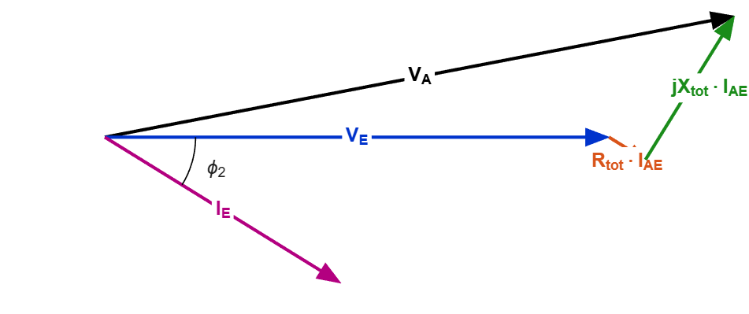 | 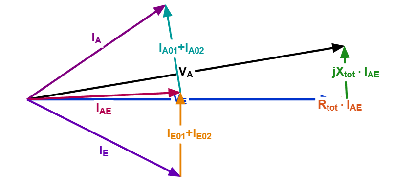 |

### Load vs efficiency and I<sub>E</sub> vs U<sub>E</sub> / I<sub>A</sub>

| Case | Load vs η | I<sub>E</sub> vs U<sub>E</sub> and I<sub>A</sub> |
|---|---|---|
| 1 | 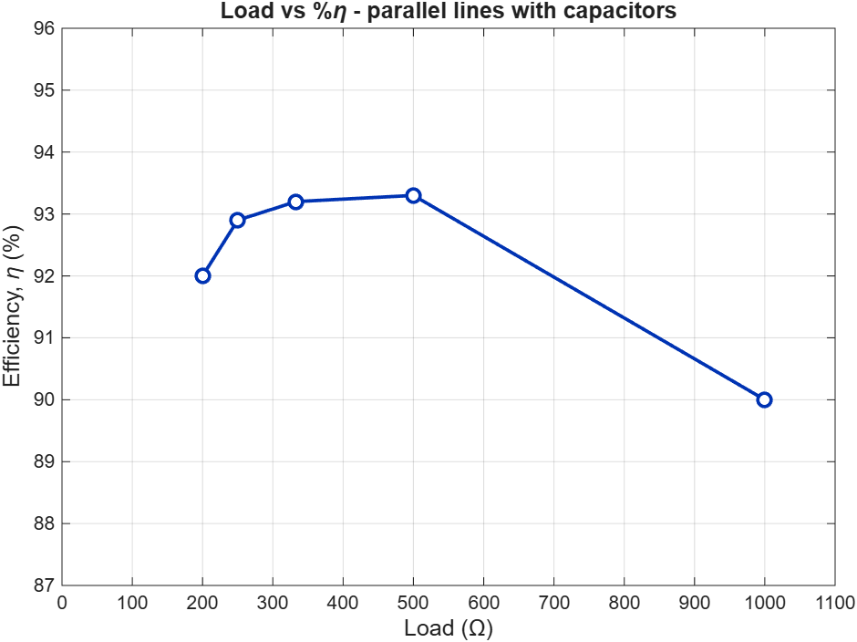 | 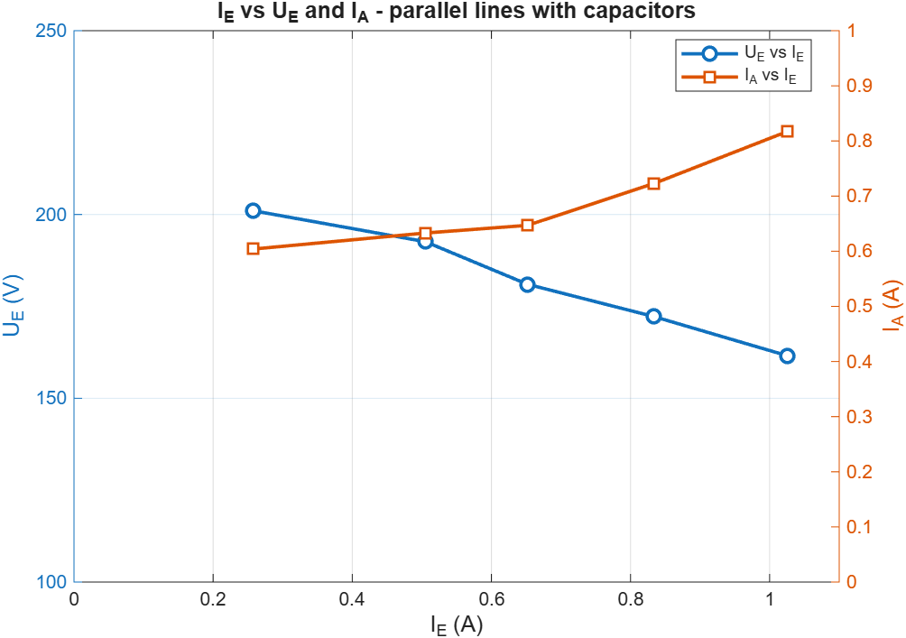 |
| 2 | 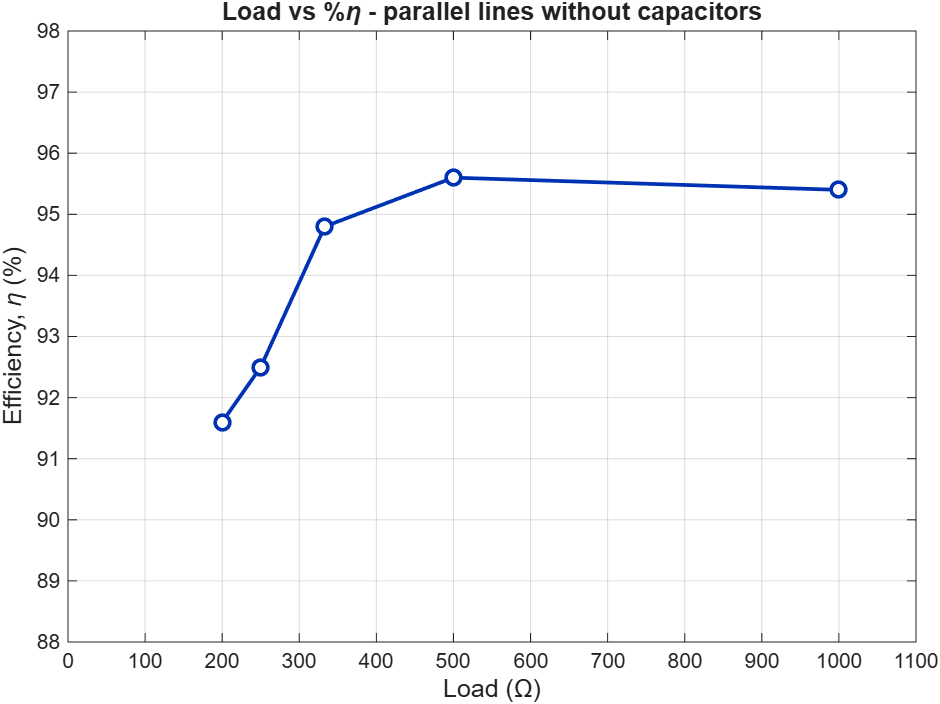 | 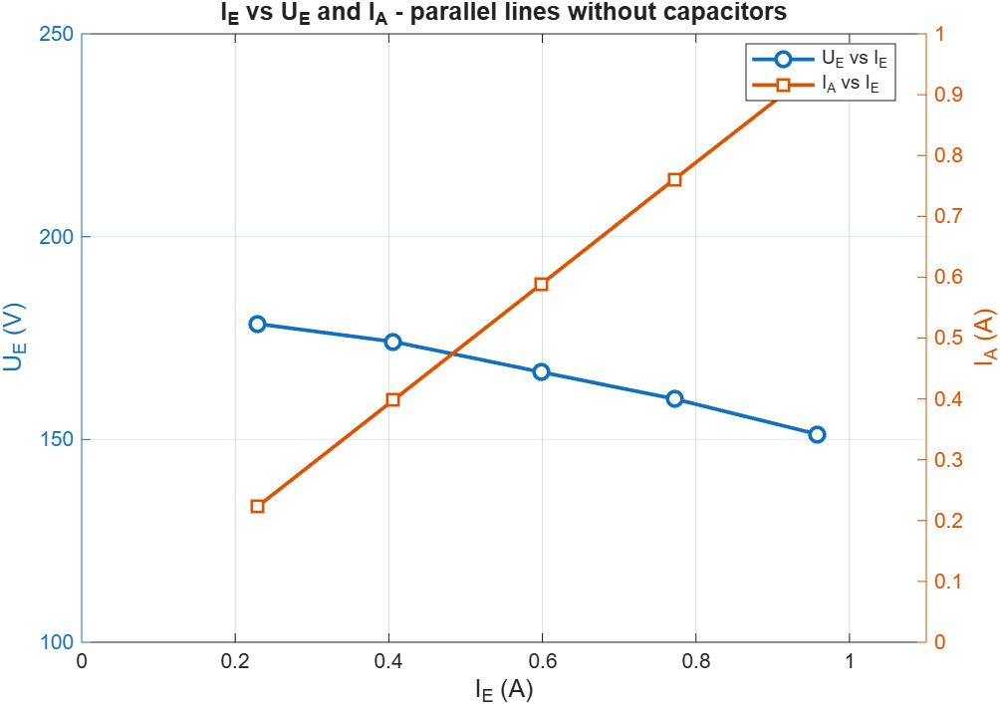 |
| 3 | 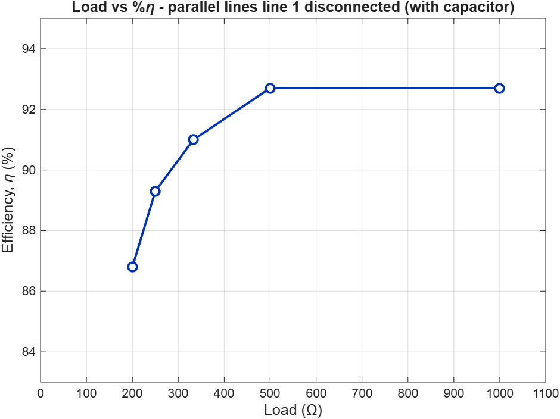 | 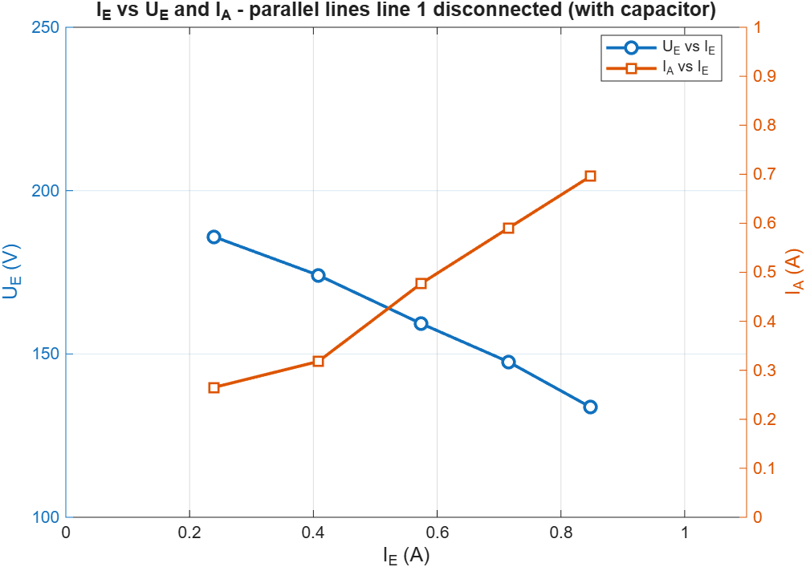 |

### Observations

- **With capacitors:** at light load the line charging current makes Q<sub>1</sub> strongly negative (−103 var at R1‑L1), so the sending end exports reactive power. Load voltage U<sub>E</sub> rises above the supply (201 V > 190.8 V), which is the **Ferranti effect**. As load increases, Q<sub>1</sub> moves toward positive and the sending-end power factor improves from 0.43 to 0.99.
- **Without capacitors:** the voltage drop is purely series (U<sub>E</sub> falls from 178.5 V to 151.3 V). I<sub>1</sub> ≈ I<sub>2</sub> at every step, which confirms the lines are nearly identical and share current equally.
- **One line disconnected:** the series impedance roughly doubles. U<sub>E</sub> falls fastest (down to 133.7 V) and efficiency at full load drops to 86.8 %, compared with ~92 % for the parallel cases.
- In all cases efficiency peaks at light-to-medium load (R1‑L1 to R2‑L2) and then decreases as I²R losses grow with current.

## Repository structure

```
├── matlab/
│   ├── lab_data.m            # measured data for all three cases
│   ├── fit_line_params.m     # least-squares estimate of R_tot, X_tot, B
│   ├── draw_phasor.m         # helper: draws a phasor with arrowhead + label
│   ├── phasor_simplified.m   # phasor diagram, simplified circuit
│   ├── phasor_with_shunt.m   # phasor diagram, circuit with shunt elements
│   ├── plot_graphs.m         # 6 graphs (load vs η, I_E vs U_E/I_A)
│   └── run_all.m             # regenerates every figure
├── data/                     # measured data as CSV
├── diagrams/                 # draw.io source + exported circuit diagrams
├── figures/                  # graphs and phasor diagrams used in the report
├── images/lab_setup.jpg      # photo of the bench
└── report/                   # full project report (PDF)
```

## How to run

Requires MATLAB (any recent release; `yyaxis` needs R2016a or newer). No toolboxes are needed.

```matlab
cd matlab
run_all          % or run plot_graphs / phasor_simplified / phasor_with_shunt individually
```

To draw the phasor diagram for a different load step, change `k` (1–5) at the top of `phasor_simplified.m` or `phasor_with_shunt.m`.

> **Note:** `loadR` in `lab_data.m` (1000/500/333/250/200 Ω) holds nominal values for the five load steps and is only used for the x‑axis of the efficiency plots.

## Equipment

2 × overhead line model, variable three-phase power supply, resistive, inductive and capacitive load banks, line capacitor module, power and power-factor meters, moving-iron voltmeters, moving-coil ammeters, and multimeters.

## References

1. J. D. Glover, M. S. Sarma, and T. J. Overbye, *Power System Analysis and Design*, 6th ed., Cengage Learning, 2018.
2. A. R. Bergen and V. Vittal, *Power Systems Analysis*, 2nd ed., Prentice Hall, 2000.
3. P. Kundur, *Power System Stability and Control*, McGraw-Hill, 1994.

## Author

**Md Istiauk Hossain Rifat**, BSc EEE (BRAC University), MEng ECE student at the University of Calgary.
